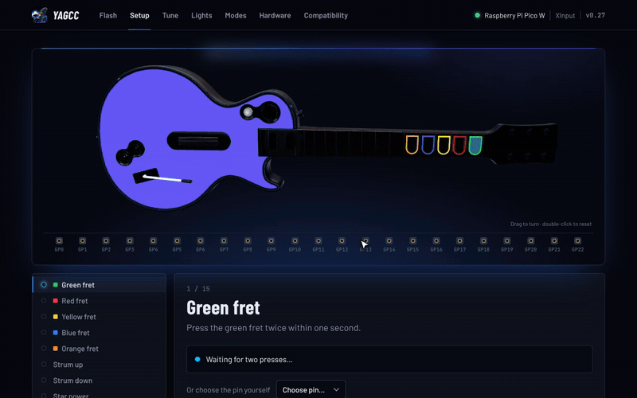

<p align="center"></p>

# YAGCC — Yet Another Guitar Controller Configurator

[](https://github.com/Cr4zySh4rk/YAGCC/actions/workflows/build.yml)
[](https://cr4zysh4rk.github.io/YAGCC/)
[](LICENSE)
[](https://cr4zysh4rk.github.io/YAGCC/)

**Free, open-source firmware and browser configurator for DIY Guitar Hero and Rock Band guitar controllers on the Raspberry Pi Pico family** (Pico, Pico W, Pico 2, Pico 2 W and RP2040 boards such as the Waveshare RP2040-Zero, SparkFun Pro Micro RP2040 and Adafruit KB2040).
Flash the board, plug it in, and the web app walks you through mapping every button, whichever pins you wired them to. Play Clone Hero, YARG, Fortnite Festival, Rock Band and Guitar Hero over USB or Bluetooth.

**Web app:** https://cr4zysh4rk.github.io/YAGCC/ (GitHub Pages) · also deployable on Vercel (see below)

> Requires a Chromium-based browser (Chrome, Edge, Brave, …) for WebUSB. Downloading firmware works in any browser.

<p align="center">
  <a href="https://cr4zysh4rk.github.io/YAGCC/"></a>
</p>

## Features at a glance

* **Any-pin button mapping**: press each fret twice and the configurator finds its pin, with a live 3D guitar that mirrors the real one.
* **Auto mode**: plug into anything and the guitar works out whether it's on Windows, macOS, Linux, a PS2, PS3, PS4, PS5, Xbox 360, Xbox One, Wii or Switch (Santroller's console detection) and becomes the right controller.
* **Many controller modes**: Xbox 360 (XInput), PS3 Guitar Hero and Rock Band, Wii Rock Band, Nintendo Switch, generic HID, keyboard (Fortnite Festival), original Xbox, and PS4, PS5 and Xbox One / Series with console authentication passed through to a licensed controller or dongle *(experimental)*. Pick a mode by holding a fret at plug-in.
* **Rumble**: a vibration motor that follows game rumble and can buzz on star power and missed notes.
* **Console ports and Wii Remote** *(experimental)*: wire the guitar straight into a **PS2 controller port** or a **Wii Remote's extension plug**, or let a Pico W be a **Wii Remote** with a guitar plugged in, for Guitar Hero on stock consoles (Santroller's emulation).
* **Bluetooth LE** on the Pico W / Pico 2 W, presenting the same controller as the USB mode, with automatic reconnects.
* **Whammy calibration**, smoothing, dead zone and per-input debounce, all live.
* **Tilt sensors**: a digital tilt switch, up to two analog tilt sensors and an I²C accelerometer (LIS3DH, SC7A20, LIS3DSH, ADXL345, MPU-6050, detected automatically), each working the whammy or star power, all at the same time as the whammy bar and star power button.
* **RGB lighting**: WS2812, SK6812 RGBW and APA102 LEDs, one or two under each fret and up to eight on the strum bar (up to 18), a lighting studio (firmware 0.34+) with 11 idle animations, 10 press reactions, individually coloured strum LEDs, star power and whammy effects, themes and a live preview.
* **No toolchain needed**: firmware downloads and in-browser flashing, update notifications, backup and restore of all settings.

An earlier 5-minute walkthrough with voice-over (from v0.4; the setup flow is the same, newer features are missing) is **[here](https://cr4zysh4rk.github.io/YAGCC/demo/yagcc-demo.mp4)**. No real guitar was used in either; a simulated controller feeds the configurator the same data the firmware sends.

## How it works

1. **Install** – download the *flash nuke* (wipes the old firmware and settings) and the YAGCC firmware for your board, or let the page write them straight to the `RPI-RP2` drive.
2. **Plug in** – the page detects the controller and points you to the next step.
3. **Buttons** – the guitar stays in view at the top of Setup while you work, and the control being set is highlighted on it; one screen with a tile for every control (five frets, strum up / down, star power, plus). Nothing listens until you ask: click **Set** on a tile, or click the control on the guitar picture (2D or 3D), and a prompt shows the guitar with that button highlighted (presses show live) and asks you to press it twice. **Clear** (with undo) removes an assignment, **Clear all** removes them all. **Map all buttons** / **Map the missing ones** go through the prompts in order, with Skip and Stop; after each button it moves on to the next one by itself (untick *Go to the next button by itself* to step through with Next instead; the choice is remembered). Pressing a button that is already used offers to move it.
4. **Whammy** – move the bar through two full sweeps; YAGCC finds the analog pin, calibrates min/max, detects direction and shows a live meter. Live readings of GP26–28 are shown, with a manual *Use pin* / *Capture rest* / *Capture full* fallback.
5. **RGB** – one question at a time: do you have LEDs, **which kind** (WS2812B / NeoPixel, SK6812 RGBW or APA102 / SK9822 / DotStar, told apart by the number of wires), the layout (0–8 strum LEDs, one or two per fret), the data pin (and clock pin for APA102), then a **light-them-up test**. If they stay dark, a troubleshooting panel checks the settings and lists the usual wiring mistakes. Then teach YAGCC the chain order by pressing the fret above each lit LED, or strumming for a strum LED.
6. **Add-ons** – Bluetooth toggle (Pico W / Pico 2 W only) and an optional tilt switch (a plain digital switch such as a mercury ball switch; tilt up twice within 5 s to register it as a star-power shortcut). Normally open (closes when tilted) and normally closed (opens when tilted) switches both work: pick *Which position counts as tilted?* (switch closed = tilted, or switch open = tilted) next to the live *Tilt: active* indicator, in Setup or on the Tune page's **Tilt switch** panel (which also sets the pin by hand), which also offers the switch when a level guitar reads as tilted (firmware 0.33+).
7. **Lights** – one flow: a one-line LED summary (*12 LEDs · WS2812B on GP7 · brightness 110*, with *Test LEDs* and *Change setup* for type, pins, colour order, brightness, layout, LED order and troubleshooting; it opens by itself while the LEDs would be dark), then **Look**: a live preview (clickable, follows the real guitar, *Preview star power* works even if the star power glow is off) beside themes and a few simple pickers for frets, strum bar and star power. Everything else (brightness, fade, whammy, sleep timer, palettes ...) is under *More options*, which shows how many of its settings are changed. Needs firmware 0.34 for the full set.
8. **Modes** – choose what the controller pretends to be, the XInput guitar type and the Fortnite Festival key bindings.
9. **Tune** – optional: debounce time (presets or slider), combined-strum debounce, whammy smoothing, dead-zone and direction, all live.
10. **Help** – *Wiring & hardware* and *Compatibility* reference pages.

Changes apply live; one bar at the bottom appears whenever something isn't saved yet, with **Save to guitar** and **Undo changes**. Expert settings (tilt sensors and accelerometer filters, rumble, PS2 / Wii ports, USB host port, Steam receiver option, Bluetooth debug log, colour order) are behind the **Advanced** switch in the header; anything already set to a non-default value stays visible.

## USB modes

| Hold at plug-in (default) | Mode | What it is | Best for |
|---|---|---|---|
| *(nothing: the default for new setups)* | **Auto** | Detects the host, then restarts as the matching mode below and stays that way until unplugged (firmware 0.30+) | Anything: see *Auto mode* below |
| Green | **XInput** | Xbox 360 guitar (Guitar Hero or Rock Band type, selectable). Answers Xbox 360 security (XSM3). On a host with no XInput driver (macOS) it switches itself to the HID gamepad | Windows / Linux / macOS, Clone Hero / YARG / Fortnite Festival (PC), Xbox 360 *(experimental)* |
| Red | **PS3 Rock Band** | Rock Band guitar `12BA:0200` (Santroller report layout: tilt → R1, star power → select) | Rock Band on PS3 / RPCS3, YARG |
| Yellow | **HID gamepad** | Generic gamepad (16 buttons, hat, 4 axes) | macOS, Linux, Android, emulators |
| Blue | **PS3 Guitar Hero** | RedOctane `12BA:0100` with the PS3 guitar handshake | Guitar Hero on PS3 / RPCS3, Clone Hero |
| Orange | **Nintendo Switch** | HORI Pokkén pad `0F0D:0092`: green A, red B, yellow Y, blue X, orange L, tilt R, star − , plus +, strum on the D-pad, whammy on the right stick | Fortnite Festival on Switch, other Switch games |
| *(assign on Modes tab)* | **Fortnite Festival (keyboard)** | USB keyboard with the Fortnite Festival *Pro guitar* default keys (frets 1–5, strum Right Shift / Right Ctrl, star power PageDown, plus Esc) | Fortnite Festival on **PS4, PS5, Xbox One/Series and PC**: consoles accept a keyboard with no authentication |
| *(assign on Modes tab)* | **Wii Rock Band** | Harmonix Wii guitar `1BAD:0004` | Rock Band on Wii / Dolphin |
| *(assign on Modes tab)* | **OG Xbox** | Original Xbox controller (XID) | Guitar Hero II / III on original Xbox *(experimental)* |
| *(assign on Modes tab)* | **PS4 / PS5 guitar** | Rock Band 4 PS4 guitar (`1532:0401`); console authentication is passed through to a controller on the USB host port | Rock Band 4 on PS4 / PS5 *(experimental, untested on a console)* |
| *(assign on Modes tab)* | **PS5 guitar** | Third-party PS5 Rock Band guitar; the console's security check and the signing of every input report are done by a Besavior **P5General** dongle on the USB host port (Santroller's approach) | PS5 games *(experimental, untested on a console)* |
| *(assign on Modes tab)* | **Xbox One / Series guitar** | Rock Band 4 Stratocaster over GIP (`0738:02EA`); authentication passed through to a controller on the USB host port | Rock Band 4 on Xbox One / Series *(experimental, untested on a console)* |
| Plus | **Setup mode** | XInput + web config for this boot only, nothing saved | |
| Star + Plus | **Bootloader** | Jumps to UF2 mode so you can reflash without touching BOOTSEL | |
| Star | **Bluetooth pairing** | Pico W / Pico 2 W: forget the old host and pair a new one (the USB mode is the default one) | |

The mode picked by holding a fret is remembered (like GP2040-CE), and every fret → mode assignment can be changed on the **Modes** tab.

**Fortnite Festival.** On a Switch, hold **orange** while plugging in (Switch mode). On PS4, PS5, Xbox and PC, assign keyboard mode to a fret on the Modes tab and hold that fret while plugging in; in Fortnite turn on *Pro* input for guitar and choose the keyboard layout that matches the bindings shown on the Modes tab (Pro guitar is the default; a Lead-lane preset — D F J K L, arrows, Space — is one click away, and every key is rebindable). On PC you can also use XInput mode with *Star power → D-pad left* switched on.

**XInput options.** The guitar can report as a *Guitar Hero* (subtype 7) or *Rock Band* (subtype 6) guitar. Whammy sits on right stick X and tilt on right stick Y, both resting at the bottom like real guitars. When a game sends star power / overdrive state over the rumble channel, the fret LEDs can glow cyan (*Star power glow* on the Lights tab).

**Auto mode.** The guitar starts as a HID gamepad that also carries the PS3 / PS4 feature reports, an Xbox 360 security interface and the Microsoft OS descriptors, and watches how the host enumerates it (Santroller's detection, `firmware/src/auto_detect.c`):

| Host does | Host is | Becomes |
|---|---|---|
| reads the Microsoft OS descriptors and the strings | Windows | XInput (as a wireless receiver slot, for Steam) |
| reads the Microsoft OS descriptors, never a string | Xbox One / Series | Xbox One guitar with an auth controller on the host port, otherwise the Fortnite Festival keyboard |
| starts the Xbox 360 security handshake | Xbox 360 | XInput |
| asks for a PS3 feature report (or RPCS3's) | PS3 / RPCS3 | PS3 Guitar Hero or Rock Band guitar (the XInput guitar type picks which) |
| asks for feature report 3 with 48 bytes | PS4 / PS5 | PS4 guitar (PS5 guitar if the auth dongle is a P5General) with an auth controller on the host port, otherwise the PS3 Rock Band guitar Rock Band 4 takes as a legacy instrument |
| clears both endpoints, or reads only the report descriptor | Switch / Switch 2 | Switch |
| asks for the XID descriptor | original Xbox | OG Xbox |
| configures it, then goes quiet | Wii / Wii U | Wii Rock Band guitar |
| reads descriptors but never configures it | PS2 | PS3 guitar (what PS2 games and OPL's PADEMU take) |
| reads strings and uses it as it is | macOS, Linux, Android | stays the HID gamepad |

It decides within a few seconds, restarts in that mode, and goes back to Auto when unplugged. Windows caches the Microsoft OS descriptors, so on a PC that has seen the guitar before it may stay the HID gamepad (Clone Hero and YARG take both); pick XInput explicitly if a game needs it.

**Steam on Windows (firmware 0.30+).** Steam's controller driver chokes on a wired XInput pad that shares its USB device with another interface (the configurator's). Like Santroller, the guitar presents itself to Windows as one controller slot of an **Xbox 360 wireless receiver** instead, with its own Microsoft OS descriptor entry so Windows binds the receiver driver. A real Xbox 360 never reads those descriptors and still gets the wired pad. From 0.38 this is **off by default** (it left the guitar unrecognised on at least one Windows PC): turn on *Steam receiver mode on Windows (experimental)* on the Modes page (Advanced) to use it. Wired XInput is used otherwise. **0.39:** the wired pad and the receiver slot now report different USB serial numbers (Windows keys its driver records on vendor id, product id and serial, so a record from one layout can no longer block the other; after updating, Windows installs the Xbox 360 driver for the guitar afresh), Auto mode stays off the bus for 300 ms before it re-enumerates, the XInput serial reply is stable, and automatic saves (hold-a-fret mode, Bluetooth pairing) never overwrite a saved config this firmware could not read; only *Save to guitar* does. **0.40:** the wired XInput pad also sends the `XUSB10` compatible id in its Microsoft OS 2.0 descriptor, which binds Windows' own Xbox 360 driver (xusb22) without a Windows Update download; before, a PC that could not fetch that driver showed the guitar as an unknown device (Code 28).

**XInput on a Mac.** macOS has no driver for Xbox 360 controllers, so in XInput mode nothing would read the guitar. If no XInput driver has used it within 10 seconds of plugging in (and the host isn't Windows), the guitar re-connects as the **HID gamepad**, which Clone Hero and YARG pick up as usual; the configurator shows *XInput → HID*. The saved mode stays XInput, and the next plug-in starts as XInput again, so the same guitar works on Windows, Linux and macOS without changing modes. (0.37+) In **Auto** mode this switch never happens once Auto has recognised Windows or an Xbox 360, so a Windows PC keeps the XInput pad and the configurator connection.

**HID gamepad layout.** Frets are buttons 1–5, star power button 6, plus button 7, strum up/down buttons 8/9 and the hat; whammy is the Z axis and the tilt sensor the Rz axis (tilt also presses button 6). Pressing star power changes only button 6, so games' remap screens record it as a plain button.

**Configuring in other modes:** XInput, HID and keyboard modes keep the WebUSB config channel (browsers grant permission per mode, so press *Connect* once after switching). PS3, Wii, Switch and OG Xbox modes have to look exactly like the real device, so they have no config channel: the Setup page finds PS3/Wii guitars over WebHID (*Find it*) and restarts them in setup mode with one click; for the others hold *Plus* while plugging in. **macOS** has no XInput driver, so use HID mode for games on a Mac.

**Console authentication (USB host port) — experimental.** PS4, PS5 and Xbox One / Series only accept licensed controllers. Like GP2040-CE, YAGCC can run a second, software USB port (Pico-PIO-USB on PIO1) and pass the console's security check through to a licensed controller plugged into it:

* Pick the port's pins on the **Modes** tab (*Console authentication*): D+ on any free GPIO, D− on the next one.
* Wire a USB-A socket: **D+** (green) and **D−** (white) to those pins, **VBUS** (red) to the board's VBUS / 5 V pin, **GND** (black) to GND.
* **PS4 / PS5 mode:** plug in a wired DualShock 4 or a USB PS4 authentication dongle. The console sends its challenge to the guitar, which forwards it to the controller and returns the signed answer. PS5 needs a PS4 controller, not a DualSense.
* **Xbox One / Series mode:** plug in a wired Xbox One / Series controller (Microsoft, PowerA, …) or a Mayflash / MagicBoots adapter. The guitar announces itself as a Rock Band 4 Stratocaster and relays the GIP security exchange; inputs are sent once the console accepts it.
* With the host port on, the firmware runs the system clock at 120 MHz (needed for USB timing) and those two pins can't be used for buttons.

This is ported from GP2040-CE's PS4 and Xbox One drivers but **has not yet been tested on a real console**; reports are welcome.

**Backup and restore.** The **Tune** tab can download all settings (wiring, tuning, lights, modes) as a JSON file and restore any of those sections later, onto the same guitar or another one. Files are checked before anything is written, and pins that would clash on the target are skipped.

**Live 3D guitar.** The Setup and Tune pages show a 3D Les Paul (blue-purple front plate, black trim) that copies the real guitar as you play it: frets press in and light up in their LED colours, the strum bar rocks up and down, the whammy bar dips as far as you push it, Star power and Plus light up, and the guitar lifts its neck when the tilt sensor fires. Drag to turn it, double-click to reset. It loads only when a page with the guitar is opened. If the browser has no hardware graphics acceleration, the flat drawing is shown instead (add `?2d` to the address to force it).

**Firmware updates.** When a guitar connects, the configurator compares its firmware version with the latest one on the site. If the guitar is older, a banner offers the update: it opens the Flash page with your board already picked, and the guitar can restart itself into update mode (no BOOTSEL button needed), so you only drop the new file on the drive that appears. Settings are kept.

See the **Compatibility** page in the web app for a game-by-game / console-by-console table with honest status labels (Supported, Experimental, Planned).

## Wiring

* Buttons: any of **GP0–GP22**, switched to **GND** (internal pull-ups are enabled).
* Whammy potentiometer: wiper to **GP26, GP27 or GP28** (ADC0–2), one end to **3V3(OUT) (pin 36)**, the other to GND/AGND. Don't power it from ADC_VREF (pin 35): on many clone boards that pin isn't fed, and the bar then barely moves the reading.
* Tilt switch: any of GP0–GP22 to GND (a mercury ball switch is fine), normally open or normally closed (firmware 0.33+).
* Analog tilt sensor: output to a free one of GP26–GP28, powered from 3V3(OUT) and GND, like the whammy pot.
* Accelerometer module (I²C): SDA to an even GPIO and SCL to the next one (GP4 / GP5, GP0 / GP1, …), VCC to 3V3(OUT), GND to GND.

### Console ports and Wii Remote (experimental)

Modes page, firmware 0.31+. Ported from Santroller; they work next to whatever USB mode is running and stay quiet until a console talks to them. Not yet tested on a console with YAGCC.

* **PS2 controller port** – a PS2 / PS1 sees a Guitar Hero guitar on its controller port (Guitar Hero 1, 2, III, 80s, Aerosmith on a stock console). Cut a PS2 extension cable and wire **ATT, CMD, DAT, CLK and ACK** to five free GPIOs (any), and GND to GND; power the board from the cable's 3.6 V (pin 5) through a diode to VSYS. Uses PIO1, so not together with the USB host port. Frets are the shoulder / face buttons like a real PS2 guitar, strum on the D-pad, star power on Select, whammy on the stick; the console's rumble drives the rumble motor.
* **Wii extension** – the guitar acts as the **Guitar Hero guitar extension** a Wii Remote plugs into, like the original Wii guitars: SDA / SCL of the extension plug to an even / odd GPIO pair (not the accelerometer's I²C block), the plug's detect line to 3V3, GND to GND. Star power is Minus.
* **Wii Remote over Bluetooth** (genuine Pico W / Pico 2 W) – the guitar *is* a Wii Remote ("Nintendo RVL-CNT-01") with a Guitar Hero guitar plugged in: Guitar Hero, Band Hero and DJ Hero on a stock Wii or Wii U, with no Wii Remote. Turn it on, press **SYNC** on the console and the guitar pairs with the Wii's legacy PIN; it remembers the console and reconnects by itself when switched on, like a real one. It replaces the Bluetooth LE gamepad while on (the firmware now carries Bluetooth Classic for it).

### Rumble

Tune page, firmware 0.30+. A small vibration motor (coin / ERM) on any free GPIO, switched by an NPN transistor (base through ~1 kΩ) or a logic-level MOSFET, with a flyback diode across the motor; never drive it straight from the pin. The pin runs 20 kHz PWM, scaled by a strength setting. It can:

* follow **game rumble**: XInput (wired and receiver), PS4 and PS5 output reports and original Xbox. On a guitar the XInput rumble channel also carries Clone Hero / YARG stage kit and star power messages (Santroller's convention); those are recognised and don't make it buzz;
* **buzz when star power starts** and **tap on a missed note**, in games that report them.

### Tilt sensors

Set up on the **Tune** page (firmware 0.29+). Besides the digital tilt switch from Setup there are two sensor slots, and each one reads from:

* an analog input (**GP26–GP28**, any not used by the whammy bar),
* one axis (**X, Y or Z**) of an I²C accelerometer: LIS3DH, SC7A20, LIS3DSH, ADXL345 or MPU-6050 and its clones, found automatically at either of its addresses,
* one axis of a **second** accelerometer on the same bus (firmware 0.36+, see below), or
* one of a **LIS3DH's three auxiliary ADC inputs**, for analog sensors wired to the accelerometer board.

**Guided setup.** Pick the accelerometer's SDA / SCL pins and the Tune page confirms when the chip is found (✓ ADXL345 found). Then choose what tilting should do (**Star power** or **Whammy**), hold the guitar level and press *Capture level*, tilt the neck up and press *Capture tilted*. The axis is worked out for you (the one that moved most), a live meter and a *Star power at* slider appear, and *Redo* starts over. With two accelerometers you also pick which chip. The detailed controls below the guided setup are still there for picking an axis by hand, thresholds and two sensors.

Each slot either **adds to the whammy** (the whammy bar and the sensor work together; whichever is pushed further wins, and the whammy dead zone applies) or **presses star power / tilt** once the guitar tilts past a threshold you set (with a little hysteresis so it doesn't flicker). Calibrate with *Set rest* (guitar level) and *Set tilted* (neck up); the direction is worked out from the two. So a guitar can have a whammy bar, a star power button, a tilt sensor on the whammy and another on star power, all at once.

**Two accelerometers (0.36+).** Wire both to the same SDA / SCL / 3V3 / GND and give the second a different address: ADXL345 SDO to GND = 0x53 and SDO to 3V3 = 0x1D; LIS3DH SA0/SDO to 3V3 = 0x19 (default 0x18); MPU-6050 AD0 high = 0x69 (default 0x68). Mixed chip types work too. The first chip found is *Accelerometer 1*, the next one at another address *Accelerometer 2*; the Tune page shows both chips and their live X / Y / Z, and each sensor slot can read any axis of either (sources 9..11 in the config). Each chip has its own filters and is found again if unplugged. The LIS3DH auxiliary ADC inputs are read from chip 1 only.

The accelerometer readings go through the same filters Santroller uses, each off at 0: a 2nd order Butterworth **low pass** (default 20 Hz), a **median** of 3–9 samples (default 3) that drops single spikes, and a **gravity gate** that holds the last reading while the guitar is being shaken (a hard strum) rather than tilted. The chip is polled with its data-ready flag so each sample is used once, and it is found again if it's unplugged.
* LED data line (WS2812 / SK6812): any free GP0–GP22. APA102 / SK9822 / DotStar also needs a clock pin (any other free GP0–GP22): wire the Pico's data pin to the first LED's DI and the clock pin to its CI.

## RGB lighting

* Up to 18 individually addressable LEDs on one chain: one or two under each fret and up to eight on the strum bar. Supported chips:
  * **WS2812 / WS2812B / NeoPixel** (one data pin, PIO-driven) with selectable colour order (GRB, RGB, BRG, …)
  * **SK6812 RGBW** (one data pin; the shared white part of a colour moves to the white LED)
  * **APA102 / SK9822 / DotStar** (data + clock on any two free pins, firmware 0.32+): clocked at a steady 4 MHz so long or ribbon-cable wiring still works, dimming done with the chip's own 5-bit brightness so dim colours and fades stay smooth, an end frame SK9822 clones accept, and a selectable colour order (BGR by default)
* **Brightness**, capped by the LED layout so the chain's current stays reasonable (each LED at full white draws up to ~60 mA): up to **255** with one LED per fret only, **160** with two per fret, **200** with strum LEDs only, **150** with one per fret plus strum LEDs, and **110** with two per fret plus strum LEDs. The firmware enforces the cap too, so a restored backup or an older configurator can't exceed it.
* **LED layout**: one chain of up to 18 LEDs – one or **two LEDs under each fret** (both in the fret's colour; side by side by default, any order through the LED order step, which then asks for each fret twice), up to eight **strum bar LEDs** (one per side, the four corners, or four along each side), or both, with the strum LEDs wired before or after the frets (or strum LEDs only). Strum LEDs have their own colour and each follows strum up, strum down or both (quick setups: all both, first half up / second half down, alternating), and they get every effect, the star power glow, the Bluetooth pairing blink and the charging sweep (which runs on from the green fret to the strum bar). With no fret LEDs, the strum LEDs flash the mode colour at plug-in.
* **Lighting studio** (firmware 0.34+, config version 7; older firmware keeps the single effect and fret colours):
  * **Live preview** of the real LED layout, driven by a JavaScript port of the firmware's lighting engine. It follows the real guitar's buttons and whammy, and you can click, tap or hold the preview's frets, strum up / down, a whammy slider and *Preview star power* to design without touching the guitar. With firmware 0.35 or newer the preview's own frets, strum, whammy slider and star power also drive the guitar's real LEDs while you use them.
  * **Themes** (one click sets everything): Guitar Hero classic, Rock Band, Neon, Synthwave, Fire, Ice, Rainbow everything, Stealth, Club strobe, Ocean wave, Heartbeat, Candy, Aurora, Mono white; plus *Copy fret settings to strum bar*.
  * **Frets and strum bar** each have an idle animation (off, solid, breathe, heartbeat, rainbow, rainbow wave, colour wave, sparkle, chase, fire, hue drift) with idle brightness and speed, and a press reaction (none, light up, flash & fade, dim, go dark, strobe, ripple, random colour, white spark, sweep) with a fade speed (1–10).
  * **Colours**: idle and pressed colour for every fret (or "pressed = idle"), an optional separate colour for the second LED of each fret, and on the strum bar one idle colour or **one colour per strum LED**, with separate **strum up** and **strum down** colours.
  * **Star power**: 7 animations, colour, speed, which zones show it, and an optional white flash when you activate it. **Whammy** effects: brightness, flutter, colour shift, wave. **LED sleep timer** (under More options): LEDs fade out after 1-30 minutes without input.
  * Per-fret colours are gamma-corrected on the LEDs (so the red and orange you pick on screen come out red and orange, not pink and peach). An **LED order wizard** lights each LED white in turn and you press the fret above it (or strum, for a strum LED).
* **Older firmware (0.31-0.33)**: one effect for all LEDs (static, dim on press, off on press, brighten on press, flash & fade, breathing, rainbow, adjustable speed) and per-fret colours with presets. The configurator shows the new options locked, with an *Update firmware* button.
* **Mode indicator**: after plug-in the fret LED that selects the running mode (green = XInput, red = PS3 Rock Band, yellow = HID, blue = PS3 Guitar Hero, orange = Switch by default) flashes for one second.
* **Star power glow**: in XInput mode, games that report star power (Clone Hero, YARG, Guitar Hero via the rumble channel) make the idle frets pulse cyan.
* **Charging / no-host sweep**: if the guitar has USB power but no host (over USB or Bluetooth) talks to it for 3 s (a phone charger or power bank, for example when the Pico's USB port also feeds a TP4056 battery charger), a soft light runs slowly from the orange fret to the green one and repeats. Held frets still light up, and normal lighting returns as soon as a PC or console connects. On the Pico and Pico 2 (and the Pico W / Pico 2 W while Bluetooth is on) the firmware also checks the USB power pin, so running from the battery alone doesn't trigger it; on other boards it's based on the missing host only.
* The LEDs work in every USB mode, including the PS3 modes where the web config is unavailable (set them up beforehand).

## Debounce

YAGCC uses a *lockout + glitch filter* engine, designed after reading how Santroller and GP2040-CE do it:

* **GP2040-CE** debounces with a per-pin lockout: the first edge is taken immediately, then changes are ignored for the delay (default 5 ms) before the input re-syncs to the raw level.
* **Santroller** lets presses through instantly and holds *releases* for the debounce time, with an optional press-delay mode and a combined strum debounce.
* **YAGCC** takes the best of both: a 0.2 ms press / 1 ms release glitch filter (so EMI spikes and contact flutter never register), then a per-input lockout (default 5 ms) after every accepted edge, then re-sync. Strum up/down additionally share a lockout so a bouncing strum switch can't fire both directions. A mercury tilt switch gets at least a 20 ms lockout.

The only knob is the lockout time (presets from Off to 20 ms, or a slider up to 25 ms). Inputs are sampled at up to 10 kHz.

## Boards

| Build | Board |
|---|---|
| `pico_clone` | Generic RP2040 "Pico-compatible" clones, including boards with an ESP8285 (Wi-Fi only) instead of a real Pico W radio. Uses the generic flash boot stage, slower flash clock and longer crystal start-up, like Santroller's `pico_w_compat`. **If unsure, use this one.** |
| `pico` / `pico_w` | Official Raspberry Pi Pico / Pico W |
| `pico2` / `pico2_w` | Official Pico 2 / Pico 2 W (RP2350) |
| `waveshare_rp2040_zero` | Waveshare RP2040-Zero (tiny, fits inside most guitar necks) |
| `waveshare_rp2040_one` | Waveshare RP2040-One |
| `sparkfun_promicro` | SparkFun Pro Micro RP2040 (Pro Micro footprint, drop-in for old Arduino builds) |
| `adafruit_kb2040` | Adafruit KB2040 (Pro Micro footprint) |

The **Hardware** page in the web app describes each board, the LED types, whammy pots, tilt sensors and wiring, and warns about fake "Pico W" boards. Arduino (ATmega32U4 / 328P) and other microcontrollers are not supported: YAGCC is RP2040/RP2350 only.

**Bluetooth** (tested on a Pico W with Windows: pairing and reconnecting after power cycles in every mode; Pico 2 W built from the same code but not yet tried) needs the CYW43 radio of a genuine Pico W / Pico 2 W; the ESP8285 on clone boards is Wi-Fi only, so the toggle is disabled there. Over Bluetooth LE (HID over GATT, BTstack) the guitar presents **the same device as over USB in the running mode**: the same input report layout and bytes and the same vendor / product ids (the report map keeps only the input report; the USB output / feature reports are console handshakes) (PS3 Guitar Hero, PS3 / Wii Rock Band, Switch, keyboard, HID gamepad, PS4). XInput, original Xbox and Xbox One aren't HID devices over USB, so over Bluetooth they use the generic gamepad. Each mode is its own Bluetooth device ("YAGCC PS3 GH", "YAGCC Switch", …) with its own address, so a host never mixes up two modes' layouts. Whether a console accepts it is up to the console: most only take their own wireless controllers.

* **Pair a new device** (like PS + Create on a PlayStation controller): hold **Star power** while plugging in or switching on. The guitar forgets the hosts paired with the mode it starts in (the other modes keep theirs), turns Bluetooth on, becomes discoverable for two minutes and the frets double-blink blue. Holding **Star power + Plus** for 5 s while it is running does the same. When a host connects, all frets light blue for a second.
* **Switch modes over Bluetooth**: hold **Star power + a fret for 3 s** to switch to the mode that fret selects at plug-in (the shortcuts on the Modes tab). The guitar saves the mode and restarts into it within a second or two, then stays discoverable for a minute so an already paired host can add that mode (pair each mode once; after that it reconnects by itself).
* Outside pairing mode it still advertises (more slowly) and accepts pairing, like Santroller does, so a host that lost its key can simply pair again; pairing mode additionally forgets every old host.
* **USB host switches Bluetooth off**: when a PC or console enumerates the guitar over USB, Bluetooth drops its host and stops advertising, so a game never gets input from both. Pairings stay saved; unplug the cable and Bluetooth comes back and the paired host reconnects. A plain charger or power bank (USB power without a host) doesn't count, so the guitar can charge while you play wirelessly.
* Reconnection: after the link is encrypted the guitar requests a 3 s link timeout (and a 7.5–15 ms connection interval), so after a power cycle the host notices quickly and reconnects. It stays off in the PS4 / Xbox One modes only when the USB host port is set up, since both need the same hardware.
* Pairing uses **LE Secure Connections** with the keys stored in flash (the two sectors below the settings sector), like BTstack's own HID examples; every mode keeps its own list of paired hosts.
* **Upgrading from v0.21 or older**: the guitar gets new Bluetooth addresses (each mode now has its own identity key, so Windows accepts several modes paired side by side) and forgets its old pairings, so pair each mode once more. Before pairing, remove every "YAGCC …" entry in Settings → Bluetooth & devices, and also in Device Manager (View → Show hidden devices → Bluetooth): Windows can keep a hidden record of an old pairing that keeps trying a stale key.
* **Bigger reports wait for the host's MTU**: a Bluetooth LE notification carries at most MTU − 3 bytes, and until the host negotiates a bigger MTU it is 23 (20 bytes). On a reconnect Windows does that only after the link is encrypted and the guitar has already been told to send, and BTstack sends an over-long notification as a PDU bigger than the MTU, which makes Windows hang up. So reports bigger than the current MTU allows (PS3 27 bytes, PS4 63) are held back until the MTU exchange; HID mode's 7 byte report always fits, which is why it reconnected and the other modes didn't.
* **Bluetooth services** (same layout as Santroller, without a Battery service since the guitar can't measure its battery): GAP, GATT (Service Changed + Database Hash), Device Information and HID. The guitar remembers which layout each paired host last saw and sends *Service Changed* when a firmware update changes it, so Windows, which caches the layout, looks again instead of giving up. Input reports go out only once the host subscribes, and the guitar then asks for a 7.5–8.75 ms connection interval, as Santroller does.
* **Bluetooth debug logging** (off by default): see [Bluetooth debug logging](#bluetooth-debug-logging).

## Scope and roadmap

YAGCC is guitar-only for now (drums and other instruments are out of scope). Experimental and untested on consoles: PS4 / PS5 and Xbox One / Series guitar modes with authentication passthrough. Bluetooth LE gamepad output is tested on Pico W with Windows. Planned, not yet implemented: wireless receivers, peripheral (wired neck) support over I²C.

## Repository layout

```
firmware/   pico-sdk + TinyUSB firmware (XInput, PS3 GH/RB, HID, keyboard, Switch, Wii RB, OG Xbox + WebUSB config),
            PS4 / Xbox One modes with auth passthrough (src/host), LED drivers, flash nuke,
            lib/xsm3 (Xbox 360 security, LGPL-2.1), lib/pico_pio_usb (USB host port, MIT)
web/        static web app (no build step) – deployed as-is; models/guitar.glb + vendor/three-yagcc.js for the 3D view
tools/      model/build_glb.py rebuilds the 3D guitar from the Sketchfab download
tests/      unit tests for pin and whammy detection
.github/    CI: builds all firmware variants and deploys the site to GitHub Pages
assets/     logo and demo media
vercel.json Vercel configuration (serves web/)
```

### Build the firmware locally

```bash
git clone --depth 1 -b 2.1.1 https://github.com/raspberrypi/pico-sdk
git -C pico-sdk submodule update --init --depth 1 lib/tinyusb
cmake -S firmware -B build -G Ninja -DPICO_BOARD=pico_clone -DPICO_SDK_PATH=$PWD/pico-sdk
cmake --build build        # build/yacc.uf2 (published as yagcc-<board>.uf2) and build/nuke/yacc_nuke.uf2
```

Pico W / Pico 2 W builds use **Santroller's BTstack fork** ([sanjay900/btstack](https://github.com/sanjay900/btstack), a BTstack 1.8 development version with their Bluetooth gamepad fixes) instead of the BTstack 1.6.2 that ships with the Pico SDK, so the guitar runs the same Bluetooth stack as Santroller's Pico W controllers. The commit is pinned in `firmware/CMakeLists.txt` (`YACC_BTSTACK_COMMIT`):

```bash
git clone https://github.com/sanjay900/btstack && git -C btstack checkout $(sed -n 's/^set(YACC_BTSTACK_COMMIT \([0-9a-f]*\))/\1/p' firmware/CMakeLists.txt)
git -C pico-sdk submodule update --init --depth 1 lib/cyw43-driver lib/lwip
cmake -S firmware -B build-w -G Ninja -DPICO_BOARD=pico_w -DPICO_SDK_PATH=$PWD/pico-sdk -DPICO_BTSTACK_PATH=$PWD/btstack
cmake --build build-w
```

### Firmware size

The firmware is built for size (`-Os`, newlib-nano, no printf engine on the plain Pico boards; timing-critical code such as the PIO USB host, the PS2 port and the Wii extension stays at `-O2`/`-O3`). Flash use from firmware 0.34: about **100 KB** on the Pico, Pico 2 and RP2040 boards and about **450 KB** on the Pico W / Pico 2 W, of which 232 KB is the CYW43439 radio firmware that the chip needs even for Bluetooth only. Each CI run lists every board's flash and RAM use in its summary. `-DYACC_LTO=ON` builds with link-time optimisation (a further ~7–11 KB; off by default, not hardware-tested).

### Bluetooth debug logging

Off by default: the guitar records nothing about its Bluetooth connections. Switching on **Debug logging** on the Setup page's Bluetooth step (saved straight away) makes the Pico W / Pico 2 W keep a Bluetooth event log in 16 KB of flash, grouped by power-on and kept across power cycles until **Clear** is pressed. It also records every Bluetooth GATT, pairing and L2CAP signalling message in both directions (except the guitar's own input reports), so the log shows the last thing a host asked for before it disconnected. Switch it off again once the problem is found.

### Tests

```bash
node tests/detect.test.mjs
node tests/firmware_version.test.mjs   # web/firmware.json must match firmware/CMakeLists.txt
```

When you bump `YACC_VERSION_MINOR`, update `web/firmware.json` too: the configurator compares a connected guitar's version with it and offers an update when the guitar is older.

### Run the site locally

```bash
python3 -m http.server -d web 8000   # then open http://localhost:8000 in Chrome
```

## Deploying

* **GitHub Pages** – automatic: every push to `main` builds the firmware for all boards and publishes `web/` plus fresh UF2s. Asset URLs are cache-busted per deploy, and the deploy step retries once on transient GitHub errors.
* **Vercel** – import the repository at <https://vercel.com/new>. `vercel.json` already points the output directory at `web/` and needs no build step. The UF2 files committed in `web/downloads/` are served directly.

## Protocol (for hackers)

Configuration travels over WebUSB vendor control transfers on interface 1 (WinUSB via MS OS 2.0 descriptors):
`0x30` info · `0x31` live status (GPIO levels, ADCs, debounced press counters) · `0x32/0x33` get/set config (96 bytes, version 4, CRC32, byte 73 = USB host port D+ pin, bytes 74–88 = LED layout (no fret LEDs, strum LED count, positions, colour, roles; strum LEDs 5–8 at 84–88); older 64-byte v3 configs are migrated on boot) · `0x34` save · `0x35` defaults · `0x36` reboot/bootloader · `0x37` set mode · `0x38` light one LED (wizard).
In the PS3 and Wii modes the configurator sends HID feature report `YAGCC!` to restart the controller once in setup mode.
See `firmware/src/config.h`, `firmware/src/usb_common.h` and `web/js/protocol.js`.

## Credits & license

Inspired by and compatible in spirit with [Santroller](https://github.com/Santroller/Santroller) and [GP2040-CE](https://github.com/OpenStickCommunity/GP2040-CE); USB identities and handshakes were studied from Santroller. Xbox 360 security uses **libxsm3** (from Santroller, LGPL-2.1, `firmware/lib/xsm3`). The 3D guitar is based on ["Guitar Hero Controller"](https://sketchfab.com/3d-models/guitar-hero-controller-bcac8f9f95a44008ad90f470326e5fca) by [CamSear16](https://sketchfab.com/CamSear16), licensed under [CC BY 4.0](http://creativecommons.org/licenses/by/4.0/); it was split into moving parts, given a blue-purple front plate with black trim, and brand marks were removed (see `tools/model/README.md`). It is rendered with **three.js** (MIT). The PS4 and Xbox One authentication passthrough is adapted from **GP2040-CE** (MIT; `firmware/src/host`, including its `xgip_protocol` and XInput host driver), and the Rock Band 4 guitar identities and report layouts follow Santroller. The USB host port uses **Pico-PIO-USB** 0.6.1 by sekigon-gonnoc (MIT, `firmware/lib/pico_pio_usb`). Ported from **Santroller** (GPL-3.0, at 0662a9ff): the console detection behind Auto mode, the PS5 / P5General passthrough, the Xbox 360 wireless receiver identity, the accelerometer driver and filters, the PS2 controller port emulation (`firmware/lib/psx_emulation`), the Wii extension emulation and extension encryption (`firmware/lib/wii_extension_emulation`) and the Wii Remote emulation (`firmware/lib/wii_remote_emulation`, itself built on the WiimoteEmulator work Santroller credits). YAGCC is licensed under **GPL-3.0** (see `LICENSE`).
